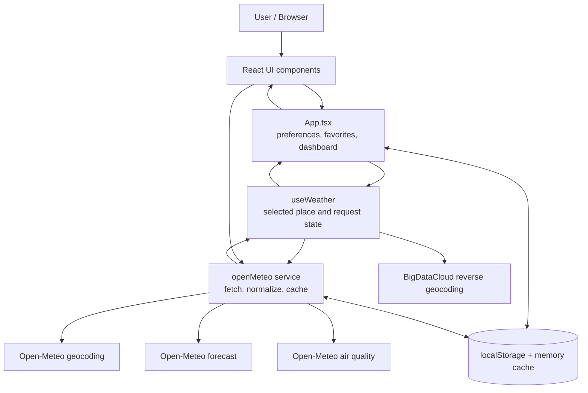

# Cloudify Architecture

## 1. System overview

Cloudify is a client-side single-page application. Vite serves the React application during development and bundles it into static assets for production. There is no application server, database, account system, or secret-bearing API proxy in this repository.



## 2. Application startup and composition

`index.html` provides the document shell and `#root` mount node. `src/main.tsx` imports global CSS and renders `App` inside React Strict Mode and `ErrorBoundary`.

`App.tsx` owns user-facing preferences, saved locations, recent searches, theme resolution, and drawer state. It composes the header/search controls, current conditions, hourly and daily forecasts, air-quality card, details grid, saved-location drawer, and footer. The visual background responds to the current weather category and day/night state.

The `components/` directory contains presentational and interaction components. Shared domain types live under `types/`; formatting, weather-code interpretation, AQI interpretation, and unit conversion live under `utils/`.

## 3. Weather request flow

1. `useWeather` initializes the selected location from `cloudify_last_location` in local storage, or falls back to London.
2. Selecting a search result updates the location. `useWeather` starts a request for its coordinates and timezone.
3. `fetchWeatherData` checks the cache, then requests Open-Meteo forecast and air-quality data concurrently.
4. Forecast data is required. A failed forecast response rejects the load and is shown in the dashboard error state. Air quality is optional: transport or response parsing failures are tolerated and parsed through `parseAirQuality`.
5. The service maps provider response arrays into `ProcessedWeatherData`: current metrics, the next 24 hourly points, up to seven daily points, AQI values, and a WMO-derived condition.
6. `useWeather` ignores stale responses when a newer location request has started, saves the successful location, and exposes loading/error/data state to `App`.

`refresh()` repeats the request for the selected place. The service uses cached data while its cache entry remains valid, so refresh can return a recent cached result.

## 4. Search and geolocation flows

### Place search

`SearchBar` debounces input by 300 ms and only searches when at least two characters are present. `searchLocations` calls Open-Meteo Geocoding, maps results to `GeoLocation`, and caches the result. The search UI tracks loading/error state, supports keyboard selection, and offers recent searches when the query is empty. Selecting a place updates the last-eight recent-search list in `App`.

### Device location

`useGeolocation` wraps the browser Geolocation API with a 10-second timeout and a 10-minute maximum-age hint. On success, `useWeather.selectCoordinates` calls `reverseGeocode`; if a place name cannot be resolved, it creates a generic “My Location” entry and still loads weather by coordinates. Location permission and device errors are displayed as a dismissible notice. Geolocation requires browser permission and typically a secure context (HTTPS or localhost).

## 5. External API boundaries

| Purpose | Provider | Required by dashboard? |
|---|---|---|
| Search place names | Open-Meteo Geocoding | No, only for search |
| Current/hourly/daily forecast | Open-Meteo Forecast | Yes |
| AQI and pollutant measurements | Open-Meteo Air Quality | No; absence is handled as AQI data by the parser |
| Coordinate-to-place lookup | BigDataCloud reverse geocoding | No; coordinate-only fallback exists |

Requests originate in the browser. No API credentials or server-side proxy are configured in the repository. Provider outages, browser network restrictions, CORS behavior, and usage policies affect the application.

## 6. Persistence and cache

User preferences, favorites, recent searches, and the last selected location use separate local-storage keys (`cloudify_user_settings`, `cloudify_saved_locations`, `cloudify_recent_searches`, and `cloudify_last_location`). They remain local to the browser profile and are not synchronized between devices.

`services/cache.ts` stores API cache envelopes in local storage and an in-memory map. The default TTL is ten minutes. Cache entries use a `cloudify_cache_` prefix; failed storage access falls back to memory where possible. Weather cache keys round coordinates to two decimal places and do not include timezone, so requests for the same rounded coordinates can reuse a result created with another timezone.

## 7. Main modules

| Path | Responsibility |
|---|---|
| `src/App.tsx` | Top-level state, theme, favorites, recents, and dashboard composition |
| `src/hooks/useWeather.ts` | Selected location, request lifecycle, stale-response protection |
| `src/hooks/useGeolocation.ts` | Browser location permission and coordinates |
| `src/hooks/useLocalStorage.ts` | JSON-backed persistent React state |
| `src/hooks/useDebounce.ts` | Debounced input value |
| `src/services/openMeteo.ts` | Geocoding, reverse geocoding, forecast/AQ API calls, response mapping |
| `src/services/cache.ts` | TTL cache in memory and local storage |
| `src/types/` | Location, preference, provider response, and normalized weather types |
| `src/utils/` | Weather codes, AQI, conversions, and date/number formatting |
| `src/components/` | Search, dashboard cards, controls, and loading/error UI |

## 8. Build and test

Vite is configured for port 5173 and exposes the development server on the host network. The production build runs TypeScript checking followed by Vite bundling. Manual chunks separate React, Recharts, and Lucide icons. Vitest is configured with a Node environment and global test APIs; tests cover utility modules.

```bash
npm run dev
npm test
npm run build
npm run preview
```

## 9. Design constraints and follow-up considerations

- The application depends on third-party APIs and a working browser network connection.
- Data and user preferences are stored only in the current browser profile; clearing site storage removes them.
- There is no backend, authentication, cross-device sync, telemetry configuration, or deployment pipeline in the repository.
- The service uses TypeScript response interfaces, but external JSON is not runtime-schema-validated before mapping.
- Forecast cache identity rounds coordinates and omits timezone, which can cause reused data to carry a different timezone context.
- Add a repository license, deployment instructions, and any provider-specific attribution required for the intended publication model before publishing.
