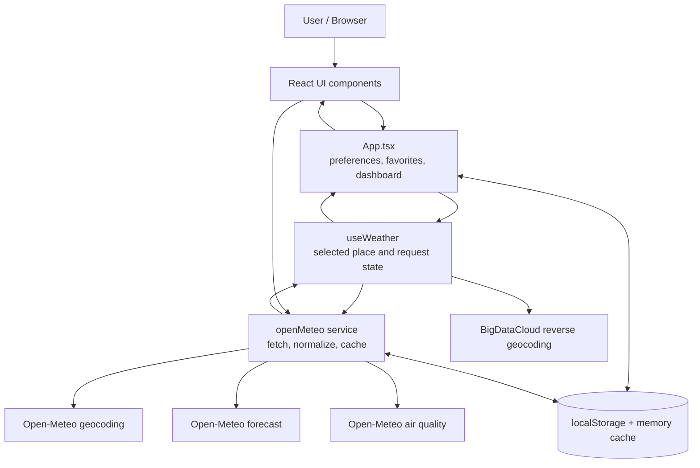

================================================
FILE: README.md
================================================
# Cloudify Weather

Cloudify is a browser-based weather dashboard built with React and TypeScript. It combines current conditions, hourly and daily forecasts, and air-quality data for a searched or current location. Weather data comes from public APIs; the app does not require a Cloudify account or API key.

## Features

- Search cities and regions with debounced autocomplete, keyboard navigation, and recent searches.
- Use browser geolocation and reverse geocoding to resolve a nearby place.
- View current conditions, a 24-hour forecast, a seven-day forecast, and weather details.
- Inspect a temperature trend chart and hourly precipitation chances.
- View US AQI and common pollutant readings when the air-quality service responds.
- Save favorite locations and customize temperature, wind, pressure, time, and theme preferences.
- Keep settings, favorites, recent searches, last location, and cached API responses in browser storage.
- Responsive layout, loading and error states, and a top-level React error boundary.

## Tech stack

- React 18, TypeScript 5, and Vite 5
- Tailwind CSS 3
- Recharts and Lucide React
- Vitest for utility unit tests

## Requirements

- Node.js 18 or newer
- npm
- A modern browser with JavaScript enabled

## Run locally

```bash
npm install
npm run dev
```

Open the local URL printed by Vite (the configured default is `http://localhost:5173`). On Windows, `run.bat` also checks for Node.js, installs dependencies if `node_modules` is absent, opens the browser, and starts the development server.

## Commands

```bash
npm run dev      # Start the Vite development server
npm test         # Run Vitest unit tests
npm run build    # Type-check and create a production build in dist/
npm run preview  # Preview the production build locally
```

## Data providers

- [Open-Meteo Geocoding API](https://open-meteo.com/en/docs/geocoding-api) for place search
- [Open-Meteo Forecast API](https://open-meteo.com/en/docs) for current, hourly, and daily weather
- [Open-Meteo Air Quality API](https://open-meteo.com/en/docs/air-quality-api) for AQI and pollutant values
- [BigDataCloud reverse geocoding](https://www.bigdatacloud.com/free-reverse-geocode-to-city-api) for resolving coordinates to a place name

These are called directly from the browser. An internet connection is required. The weather request is required for the dashboard; the air-quality request is optional and handled separately. Provider availability, coverage, terms, and attribution requirements apply. Review the providers' current terms before public or commercial deployment.

## Repository layout

```text
src/
  components/   Dashboard, search, forecast, settings, and state components
  hooks/        Weather orchestration, geolocation, debounce, local storage
  services/     API clients and browser cache
  types/        Location, settings, and weather data types
  utils/        Formatting, unit conversions, AQI, and weather-code mappings
  App.tsx       App state and dashboard composition
  main.tsx      React entry point
```

See [ARCHITECTURE.md](./ARCHITECTURE.md) for the component structure, data flow, persistence, and operational notes.

## Tests

The repository includes Vitest unit tests for AQI interpretation, unit conversion, and weather-code mapping. Run them with `npm test`; this README does not assume a test count or test result.

## License

No license file is currently included. Add a `LICENSE` file before describing this repository as open source or granting reuse rights.


================================================
FILE: ARCHITECTURE.md
================================================
# Cloudify Architecture

## 1. System overview

Cloudify is a client-side single-page application. Vite serves the React application during development and bundles it into static assets for production. There is no application server, database, account system, or secret-bearing API proxy in this repository.



## 2. Application startup and composition

`index.html` provides the document shell and `#root` mount node. `src/main.tsx` imports global CSS and renders `App` inside React Strict Mode and `ErrorBoundary`.

`App.tsx` owns user-facing preferences, saved locations, recent searches, theme resolution, and drawer state. It composes the header/search controls, current conditions, hourly and daily forecasts, air-quality card, details grid, saved-location drawer, and footer. The visual background responds to the current weather category and day/night state.

The `components/` directory contains presentational and interaction components. Shared domain types live under `types/`; formatting, weather-code interpretation, AQI interpretation, and unit conversion live under `utils/`.

## 3. Weather request flow

1. `useWeather` initializes the selected location from `cloudify_last_location` in local storage, or falls back to London.
2. Selecting a search result updates the location. `useWeather` starts a request for its coordinates and timezone.
3. `fetchWeatherData` checks the cache, then requests Open-Meteo forecast and air-quality data concurrently.
4. Forecast data is required. A failed forecast response rejects the load and is shown in the dashboard error state. Air quality is optional: transport or response parsing failures are tolerated and parsed through `parseAirQuality`.
5. The service maps provider response arrays into `ProcessedWeatherData`: current metrics, the next 24 hourly points, up to seven daily points, AQI values, and a WMO-derived condition.
6. `useWeather` ignores stale responses when a newer location request has started, saves the successful location, and exposes loading/error/data state to `App`.

`refresh()` repeats the request for the selected place. The service uses cached data while its cache entry remains valid, so refresh can return a recent cached result.

## 4. Search and geolocation flows

### Place search

`SearchBar` debounces input by 300 ms and only searches when at least two characters are present. `searchLocations` calls Open-Meteo Geocoding, maps results to `GeoLocation`, and caches the result. The search UI tracks loading/error state, supports keyboard selection, and offers recent searches when the query is empty. Selecting a place updates the last-eight recent-search list in `App`.

### Device location

`useGeolocation` wraps the browser Geolocation API with a 10-second timeout and a 10-minute maximum-age hint. On success, `useWeather.selectCoordinates` calls `reverseGeocode`; if a place name cannot be resolved, it creates a generic “My Location” entry and still loads weather by coordinates. Location permission and device errors are displayed as a dismissible notice. Geolocation requires browser permission and typically a secure context (HTTPS or localhost).

## 5. External API boundaries

| Purpose | Provider | Required by dashboard? |
|---|---|---|
| Search place names | Open-Meteo Geocoding | No, only for search |
| Current/hourly/daily forecast | Open-Meteo Forecast | Yes |
| AQI and pollutant measurements | Open-Meteo Air Quality | No; absence is handled as AQI data by the parser |
| Coordinate-to-place lookup | BigDataCloud reverse geocoding | No; coordinate-only fallback exists |

Requests originate in the browser. No API credentials or server-side proxy are configured in the repository. Provider outages, browser network restrictions, CORS behavior, and usage policies affect the application.

## 6. Persistence and cache

User preferences, favorites, recent searches, and the last selected location use separate local-storage keys (`cloudify_user_settings`, `cloudify_saved_locations`, `cloudify_recent_searches`, and `cloudify_last_location`). They remain local to the browser profile and are not synchronized between devices.

`services/cache.ts` stores API cache envelopes in local storage and an in-memory map. The default TTL is ten minutes. Cache entries use a `cloudify_cache_` prefix; failed storage access falls back to memory where possible. Weather cache keys round coordinates to two decimal places and do not include timezone, so requests for the same rounded coordinates can reuse a result created with another timezone.

## 7. Main modules

| Path | Responsibility |
|---|---|
| `src/App.tsx` | Top-level state, theme, favorites, recents, and dashboard composition |
| `src/hooks/useWeather.ts` | Selected location, request lifecycle, stale-response protection |
| `src/hooks/useGeolocation.ts` | Browser location permission and coordinates |
| `src/hooks/useLocalStorage.ts` | JSON-backed persistent React state |
| `src/hooks/useDebounce.ts` | Debounced input value |
| `src/services/openMeteo.ts` | Geocoding, reverse geocoding, forecast/AQ API calls, response mapping |
| `src/services/cache.ts` | TTL cache in memory and local storage |
| `src/types/` | Location, preference, provider response, and normalized weather types |
| `src/utils/` | Weather codes, AQI, conversions, and date/number formatting |
| `src/components/` | Search, dashboard cards, controls, and loading/error UI |

## 8. Build and test

Vite is configured for port 5173 and exposes the development server on the host network. The production build runs TypeScript checking followed by Vite bundling. Manual chunks separate React, Recharts, and Lucide icons. Vitest is configured with a Node environment and global test APIs; tests cover utility modules.

```bash
npm run dev
npm test
npm run build
npm run preview
```

## 9. Design constraints and follow-up considerations

- The application depends on third-party APIs and a working browser network connection.
- Data and user preferences are stored only in the current browser profile; clearing site storage removes them.
- There is no backend, authentication, cross-device sync, telemetry configuration, or deployment pipeline in the repository.
- The service uses TypeScript response interfaces, but external JSON is not runtime-schema-validated before mapping.
- Forecast cache identity rounds coordinates and omits timezone, which can cause reused data to carry a different timezone context.
- Add a repository license, deployment instructions, and any provider-specific attribution required for the intended publication model before publishing.


================================================
FILE: index.html
================================================
<!doctype html>
<html lang="en">
  <head>
    <meta charset="UTF-8" />
    <link rel="icon" type="image/svg+xml" href="data:image/svg+xml,<svg xmlns='http://www.w3.org/2000/svg' viewBox='0 0 24 24' fill='none' stroke='%2338bdf8' stroke-width='2' stroke-linecap='round' stroke-linejoin='round'><path d='M17.5 19H9a7 7 0 1 1 6.71-9h1.79a4.5 4.5 0 1 1 0 9Z'/></svg>" />
    <meta name="viewport" content="width=device-width, initial-scale=1.0" />
    <title>Cloudify - Weather Forecast & Air Quality</title>
    <meta name="description" content="Production-quality modern weather forecast web app powered by Open-Meteo." />
    <!-- Google Fonts Inter -->
    <link rel="preconnect" href="https://fonts.googleapis.com">
    <link rel="preconnect" href="https://fonts.gstatic.com" crossorigin>
    <link href="https://fonts.googleapis.com/css2?family=Inter:wght@300;400;500;600;700;800&display=swap" rel="stylesheet">
  </head>
  <body class="min-h-screen antialiased bg-slate-100 text-slate-800 dark:bg-slate-950 dark:text-slate-100 selection:bg-sky-500 selection:text-white">
    <div id="root"></div>
    <script type="module" src="/src/main.tsx"></script>
  </body>
</html>


================================================
FILE: package.json
================================================
{
  "name": "cloudify",
  "private": true,
  "version": "1.0.0",
  "type": "module",
  "scripts": {
    "dev": "vite",
    "build": "tsc && vite build",
    "preview": "vite preview",
    "test": "vitest run"
  },
  "dependencies": {
    "clsx": "^2.1.1",
    "lucide-react": "^0.468.0",
    "react": "^18.3.1",
    "react-dom": "^18.3.1",
    "recharts": "^2.15.0",
    "tailwind-merge": "^2.5.5"
  },
  "devDependencies": {
    "@types/node": "^20.17.10",
    "@types/react": "^18.3.18",
    "@types/react-dom": "^18.3.5",
    "@vitejs/plugin-react": "^4.3.4",
    "autoprefixer": "^10.4.20",
    "postcss": "^8.4.49",
    "tailwindcss": "^3.4.17",
    "typescript": "^5.6.3",
    "vite": "^5.4.11",
    "vitest": "^2.1.8"
  }
}


================================================
FILE: postcss.config.js
================================================
export default {
  plugins: {
    tailwindcss: {},
    autoprefixer: {},
  },
}


================================================
FILE: run.bat
================================================
@echo off
setlocal enabledelayedexpansion
title Cloudify - Weather Forecast App

cd /d "%~dp0"

echo ========================================================
echo   Starting Cloudify Weather Forecast Web App...
echo ========================================================
echo.

:: Check if node is in PATH, otherwise append known installation paths
where node >nul 2>&1
if %ERRORLEVEL% neq 0 (
    if exist "%LOCALAPPDATA%\nodejs\node.exe" (
        set "PATH=%LOCALAPPDATA%\nodejs;%PATH%"
    ) else if exist "C:\Program Files\nodejs\node.exe" (
        set "PATH=C:\Program Files\nodejs;%PATH%"
    ) else if exist "%USERPROFILE%\.gemini\antigravity\bin\node.exe" (
        set "PATH=%USERPROFILE%\.gemini\antigravity\bin;%PATH%"
    )
)

where node >nul 2>&1
if %ERRORLEVEL% neq 0 (
    echo [ERROR] Node.js was not found in your PATH or standard install directories.
    echo Please install Node.js from https://nodejs.org/
    echo.
    pause
    exit /b 1
)

:: Check if node_modules exists, install if missing
if not exist "node_modules\" (
    echo [INFO] Installing dependencies...
    call npm install
    if %ERRORLEVEL% neq 0 (
        echo [ERROR] npm install failed.
        pause
        exit /b 1
    )
)

:: Automatically launch the default browser after 2 seconds
echo [INFO] Launching browser at http://localhost:5173/ ...
start "" cmd /c "timeout /t 2 /nobreak >nul && start http://localhost:5173"

:: Start the Vite development server
echo [INFO] Starting Vite development server...
echo Press Ctrl+C in this window anytime to stop the server.
echo.
call npm run dev

if %ERRORLEVEL% neq 0 (
    echo.
    echo [ERROR] Server stopped with an error code: %ERRORLEVEL%
    pause
)


================================================
FILE: start.cmd
================================================
@echo off
call "%~dp0run.bat"


================================================
FILE: tailwind.config.js
================================================
/** @type {import('tailwindcss').Config} */
export default {
  content: [
    "./index.html",
    "./src/**/*.{js,ts,jsx,tsx}",
  ],
  darkMode: 'class',
  theme: {
    extend: {
      fontFamily: {
        sans: ['Inter', 'system-ui', '-apple-system', 'BlinkMacSystemFont', 'Segoe UI', 'Roboto', 'sans-serif'],
      },
      animation: {
        'fade-in': 'fadeIn 0.3s ease-out forwards',
        'slide-up': 'slideUp 0.4s ease-out forwards',
        'pulse-subtle': 'pulseSubtle 3s cubic-bezier(0.4, 0, 0.6, 1) infinite',
        'float-slow': 'float 8s ease-in-out infinite',
        'sun-glow': 'sunGlow 4s ease-in-out infinite',
      },
      keyframes: {
        fadeIn: {
          '0%': { opacity: '0' },
          '100%': { opacity: '1' },
        },
        slideUp: {
          '0%': { opacity: '0', transform: 'translateY(12px)' },
          '100%': { opacity: '1', transform: 'translateY(0)' },
        },
        pulseSubtle: {
          '0%, 100%': { opacity: '1' },
          '50%': { opacity: '0.85' },
        },
        float: {
          '0%, 100%': { transform: 'translateY(0px)' },
          '50%': { transform: 'translateY(-6px)' },
        },
        sunGlow: {
          '0%, 100%': { filter: 'drop-shadow(0 0 15px rgba(251, 191, 36, 0.4))' },
          '50%': { filter: 'drop-shadow(0 0 25px rgba(251, 191, 36, 0.75))' },
        }
      }
    },
  },
  plugins: [],
}


================================================
FILE: tsconfig.json
================================================
{
  "compilerOptions": {
    "target": "ES2020",
    "useDefineForClassFields": true,
    "lib": ["ES2020", "DOM", "DOM.Iterable"],
    "module": "ESNext",
    "skipLibCheck": true,
    "moduleResolution": "bundler",
    "allowSyntheticDefaultImports": true,
    "resolveJsonModule": true,
    "isolatedModules": true,
    "noEmit": true,
    "jsx": "react-jsx",
    "strict": true,
    "noUnusedLocals": true,
    "noUnusedParameters": true,
    "noFallthroughCasesInSwitch": true
  },
  "include": ["src"],
  "references": [{ "path": "./tsconfig.node.json" }]
}


================================================
FILE: tsconfig.node.json
================================================
{
  "compilerOptions": {
    "composite": true,
    "skipLibCheck": true,
    "module": "ESNext",
    "moduleResolution": "bundler",
    "allowSyntheticDefaultImports": true
  },
  "include": ["vite.config.ts"]
}


================================================
FILE: vite.config.ts
================================================
/// <reference types="vitest" />
import { defineConfig } from 'vite';
import react from '@vitejs/plugin-react';

export default defineConfig({
  plugins: [react()],
  server: {
    port: 5173,
    host: true,
  },
  build: {
    rollupOptions: {
      output: {
        manualChunks: {
          'vendor-react': ['react', 'react-dom'],
          'vendor-charts': ['recharts'],
          'vendor-icons': ['lucide-react'],
        },
      },
    },
  },
  test: {
    globals: true,
    environment: 'node',
  },
});


Directory structure:
└── parthjeevanpanchal-cloudify---weather-forecast-website/
    ├── README.md
    ├── ARCHITECTURE.md
    ├── index.html
    ├── package.json
    ├── postcss.config.js
    ├── run.bat
    ├── start.cmd
    ├── tailwind.config.js
    ├── tsconfig.json
    ├── tsconfig.node.json
    └── vite.config.ts


Repository: parthjeevanpanchal/cloudify---weather-forecast-website
Commit: cfa18b54a81635c27a81c33ac5fbf3f75843ae26
Files analyzed: 11

Estimated tokens: 4.5k
